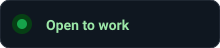

# Hi, I’m Humoyun 👋

  

  

I build production-minded web applications from idea to deployment. My focus is creating reliable frontend experiences, well-structured backend services, and maintainable code that can grow with a team or a product.

I am continuously developing my skills in full-stack architecture, databases, testing, security, DevOps, and system design.

  
  

---

## About Me

- 💻 Building complete web applications across the frontend and backend
- ⚛️ Developing reusable, responsive interfaces with React and Next.js
- 🔧 Designing REST APIs and backend services with Node.js
- 🗄️ Modeling data and working with SQL and NoSQL databases
- 🔐 Implementing validation, authentication, authorization, and secure API patterns
- 🧪 Writing testable code and checking APIs with automated and manual tests
- 🚀 Learning deployment, Docker, CI/CD, performance, and system design
- 🤝 Interested in teamwork, code review, documentation, and clean Git workflows

---

## Tech Stack

### Programming Languages

   <strong>JavaScript</strong>
  &nbsp;&nbsp;
   <strong>TypeScript</strong>
  &nbsp;&nbsp;
   <strong>Python</strong>
  &nbsp;&nbsp;
   <strong>SQL</strong>
  &nbsp;&nbsp;
   <strong>Bash</strong>

<small>`JavaScript` · `TypeScript` · `Python` · `SQL` · `Bash`</small>

---

### Frontend Development

   <strong>HTML5</strong>
  &nbsp;&nbsp;
   <strong>CSS3</strong>
  &nbsp;&nbsp;
   <strong>React</strong>
  &nbsp;&nbsp;
   <strong>Next.js</strong>
  &nbsp;&nbsp;
   <strong>Sass</strong>
  &nbsp;&nbsp;
   <strong>Tailwind CSS</strong>
  &nbsp;&nbsp;
   <strong>Redux</strong>

<small>`HTML5` · `CSS3` · `React` · `Next.js` · `Sass` · `Tailwind CSS` · `Redux`</small>

---

### Backend Development

   <strong>Node.js</strong>
  &nbsp;&nbsp;
   <strong>Express.js</strong>
  &nbsp;&nbsp;
   <strong>NestJS</strong>
  &nbsp;&nbsp;
   <strong>Python</strong>
  &nbsp;&nbsp;
   <strong>FastAPI</strong>

  <path fill='%238b949e' d='M12 17a2 2 0 1 0 0-4 2 2 0 0 0 0 4zm6-6V9a6 6 0 0 0-12 0v2H4v10h16V11h-2z'/></svg>" width="18" height="18" alt="Authentication" /> <strong>Authentication</strong>
  &nbsp;&nbsp;
  <path fill='%238b949e' d='M12 1L3 5v6c0 5.25 3.75 10.74 9 12 5.25-1.26 9-6.75 9-12V5l-9-4z'/></svg>" width="18" height="18" alt="Authorization" /> <strong>Authorization</strong>

<small>`Node.js` · `Express.js` · `NestJS` · `REST APIs` · `FastAPI` · `Authentication` · `Authorization`</small>

---

### Databases & Data Tools

   <strong>PostgreSQL</strong>
  &nbsp;&nbsp;
   <strong>MongoDB</strong>
  &nbsp;&nbsp;
   <strong>Redis</strong>
  &nbsp;&nbsp;
   <strong>Prisma</strong>

<small>`PostgreSQL` · `MongoDB` · `Redis` · `Prisma` · `Database Design` · `SQL Queries`</small>

---

### DevOps, Testing & Tools

   <strong>Git</strong>
  &nbsp;&nbsp;
   <strong>GitHub</strong>
  &nbsp;&nbsp;
   <strong>Docker</strong>
  &nbsp;&nbsp;
   <strong>Linux</strong>
  &nbsp;&nbsp;
   <strong>Nginx</strong>
  &nbsp;&nbsp;
   <strong>Jest</strong>
  &nbsp;&nbsp;
   <strong>Postman</strong>
  &nbsp;&nbsp;
   <strong>VS Code</strong>

<small>`Git` · `GitHub` · `Docker` · `Linux` · `Nginx` · `Jest` · `Postman` · `VS Code`</small>

---

## Full-Stack Development Skills

### Application Architecture

- Structuring applications into reusable and maintainable modules
- Separating UI, business logic, API, and data-access responsibilities
- Designing reusable components, services, and utilities
- Managing frontend state and asynchronous data flows
- Building responsive and accessible user interfaces

### Backend & API Engineering

- Designing RESTful endpoints and consistent response formats
- Request validation, centralized error handling, and logging
- Authentication and role-based authorization
- Pagination, filtering, search, and API documentation
- Secure handling of environment variables and sensitive data

### Database Engineering

- Designing relational tables and document-based collections
- Creating relationships, indexes, and database constraints
- Writing efficient queries and using migrations
- Using an ORM where it improves productivity and maintainability
- Applying caching concepts with Redis when appropriate

### Quality & Delivery

- Writing readable, reusable, and type-safe code
- Testing business logic and API behavior
- Debugging with logs, browser tools, and API clients
- Using branches, pull requests, reviews, and meaningful commits
- Containerizing applications with Docker
- Learning CI/CD and production deployment workflows

---

## Development Approach

1. **Understand the problem** — clarify requirements and user flows.
2. **Plan the solution** — choose the architecture, data model, and API structure.
3. **Build in small steps** — create reusable components and focused services.
4. **Validate quality** — test functionality, edge cases, responsiveness, and security.
5. **Review and improve** — refactor duplicated code and optimize performance.
6. **Document and deliver** — keep setup instructions, API details, and Git history clear.

---

## Featured Projects

### Journey Savior

A web application project focused on a modern, intuitive, and user-friendly experience. The project reflects my interest in responsive UI development, practical user flows, and product-focused improvements.

### Amiclinic

A responsive healthcare website built with a clean interface and structured user experience. It demonstrates my focus on accessible layouts, organized components, and polished frontend presentation.

> More full-stack projects, API integrations, and open-source work are coming soon.

---

## Currently Learning & Improving

`Advanced TypeScript` · `Next.js` · `NestJS` · `PostgreSQL` · `Docker` · `Testing` · `System Design` · `CI/CD` · `Cloud Deployment` · `Web Security`

### Current Goals

- Build and deploy complete full-stack applications
- Improve backend architecture and database performance
- Write more reliable unit and integration tests
- Learn scalable system design and cloud fundamentals
- Contribute to open-source projects

---

## GitHub Statistics

  

  

  

---

## Connect With Me

  
  

---

  <i>Learn. Build. Improve. 🚀</i>

